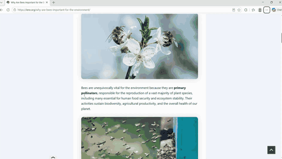

# LinguaPop

> **A lightweight desktop assistant for reading & learning English.**

**LinguaPop** is a lightweight, all-in-one desktop companion designed to make reading, translating, and learning English effortless on Windows. With global hotkeys, you can instantly translate selected text, extract text from any screen region using OCR, and listen to natural AI neural pronunciations right beside your mouse cursor without breaking your workflow.

---

## Demo



LinguaPop can translate selected text, extract text from a screen region with OCR, and play the source or translated pronunciation without leaving the current application.

---

## Key Features

- **Instant Selection Translation:** Highlight text in any application (browser, PDF, Word, code editor) and press a hotkey to see translated results in a sleek popup.
- **Screen OCR Extraction:** Capture text from non-selectable areas (images, videos, scanned PDFs) with ultra-fast offline OCR.
- **Local Neural Text-to-Speech (TTS):** Hear native pronunciations from pretrained Piper ONNX voices loaded locally for fast offline inference.
- **Pronunciation Feedback:** Record your English reading and see word-level green/yellow/red feedback against the reference text.
- **Dedicated Pronunciation Hotkey:** Speak highlighted words or sentences directly on-the-fly.
- **Translation History:** Keep track of past translations with search, quick copy, and audio replay.
- **Long Text Chunking:** Automatically segments long passages into sentences to preserve translation quality.

---

## Technologies & Libraries Used

This project is optimized for speed and low resource consumption using open-source technologies:

- **Neural Machine Translation (NMT):** [MarianMT](https://huggingface.co/docs/transformers/model_doc/marian) (`opus-mt-en-vi`) fine-tuned on the MTet dataset and academic/IELTS parallel corpora.
- **Inference Engine:** [CTranslate2](https://github.com/OpenNMT/CTranslate2) with 8-bit quantization (`int8`) for near-instant CPU/GPU inference.
- **Optical Character Recognition (OCR):** [RapidOCR](https://github.com/RapidAI/RapidOCR) (`rapidocr_onnxruntime`), combined with `OpenCV` and `Pillow`.
- **Text-to-Speech (TTS):** [Piper](https://github.com/rhasspy/piper) pretrained ONNX voices, with [pygame](https://github.com/pygame/pygame) for in-memory audio playback.
- **Speech Recognition:** [Faster-Whisper Tiny](https://huggingface.co/Systran/faster-whisper-tiny), a pretrained multilingual model using CTranslate2 (`int8` on CPU by default).
- **User Interface (UI):** Pure `tkinter` with custom dark styling and DPI awareness for crisp rendering on high-resolution displays.
- **System Interaction:** `pynput` for global hotkey hooks, `pyperclip` for clipboard integration.

---

## Installation & Setup with Virtual Environment (venv)

Ensure you have **Python 3.8 to 3.11** installed.

### 1. Create a Virtual Environment (`venv`)

Open your terminal in the project root directory and run:

```bash
# Windows
python -m venv venv
```

### 2. Activate the Virtual Environment

- **Windows (PowerShell):**
  ```powershell
  .\venv\Scripts\Activate.ps1
  ```
  *(If you get a script execution policy restriction, run `Set-ExecutionPolicy -Scope Process -ExecutionPolicy Bypass` first)*

- **Windows (Command Prompt / cmd.exe):**
  ```cmd
  venv\Scripts\activate.bat
  ```

- **Windows (Git Bash) / Linux / macOS:**
  ```bash
  source venv/Scripts/activate  # on Windows Git Bash
  # source venv/bin/activate    # on Linux/macOS
  ```

### 3. Install Dependencies

Once the virtual environment is activated `(venv)`, install all dependencies:

```bash
pip install -r requirements.txt
```

The first pronunciation check downloads the configured pretrained model; subsequent checks use its local cache. Click **Check EN** in a translation popup, then read the source text aloud while the microphone records. Green marks words recognized as written, yellow marks close transcript matches, and red marks mismatches or missed words. The score is based on word error rate, so it is a transcript-match estimate rather than a phoneme-, accent-, or tone-level assessment. Configure the model, language, inference device, and recording duration under `pronunciation` in `config.yaml`. The model requires 16 kHz microphone audio.

---

## Step 1: Convert the Model to CTranslate2

After downloading or fine-tuning your MarianMT model (e.g., in a `final_model/` directory):

```bash
python scripts/convert_to_ct2.py --model path/to/final_model
```

This command converts the model into optimized CTranslate2 format and creates:
- `models/en-vi-ct2/`
- `models/tokenizer-en-vi/`

---

## Step 2: Run the App

Launch LinguaPop with:

```bash
python src/main.py
```

---

## Shortcuts & Controls

| Shortcut / Key | Action | Description |
| :--- | :--- | :--- |
| **`A`, `A`** | **Translate Highlighted Text** | Press A twice quickly to translate selected text EN ➔ VI. |
| **`B`, `B`** | **OCR Screen & Translate** | Press B twice quickly, then drag a bounding box to extract and translate text. |
| **`C`, `C`** | **Pronounce Selection** | Press C twice quickly to pronounce selected text out loud. |

Double-tap keys must be pressed and released twice within 0.4 seconds. Customize these bindings in `hotkeys` in `config.yaml`. Existing combinations such as `ctrl+shift+y` remain supported. Note: letter double-taps are ordinary key presses too, so `aa`/`bb`/`cc` can be inserted into the active application or replace selected text in editable fields. Use modifier combinations instead when that would be disruptive.
## License

Distributed under the **MIT License**. Intended for academic and personal use.

---

## Acknowledgements

- **Models:** [Helsinki-NLP/opus-mt-en-vi](https://huggingface.co/Helsinki-NLP/opus-mt-en-vi), MTET Parallel Corpus.
- **Inference & NMT:** [CTranslate2](https://github.com/OpenNMT/CTranslate2), [Marian NMT](https://github.com/marian-nmt/marian), [Hugging Face Transformers](https://github.com/huggingface/transformers).
- **OCR:** [RapidOCR](https://github.com/RapidAI/RapidOCR).
- **Audio & TTS:** [Piper](https://github.com/rhasspy/piper), [pygame](https://github.com/pygame/pygame).
